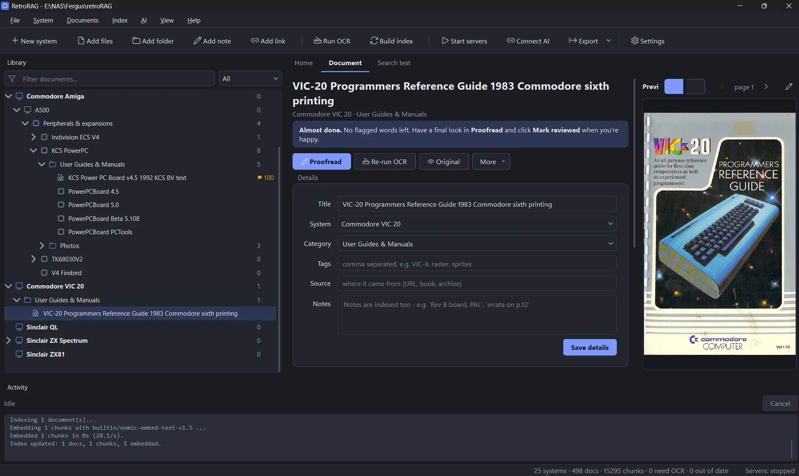

# RetroRAG

A Windows app (initially) for building a **retrieval (RAG) library of retro computer & console documentation** that Claude
and other AI systems (including locally hosted ones such as Unsloth Studio, Ollama, LM Studio) can search.



- Organise by **system** (C64, Amiga 500, ZX Spectrum, NES…) and **category**: user guides, programming reference,
  schematics, pinouts, chip datasheets, service & repair, photos, books & magazines, source code, firmware &
  ROMs, disk & tape images.
- Add **PDF, GIF, JPG, PNG, TIFF, BMP, TXT, MD, HTML, RTF, Word (DOC/DOCX), Excel (XLS/XLSX), source code, ROMs, disk/tape images, archives (ZIP, .tar.gz, .tgz, .tar.bz2, .tar.xz) and compressed files (.gz, .bz2, .xz)**, or whole folders
  (e.g. an emulator's source tree). Drag & drop onto a system or category. Each file's category is guessed
  from its type, so a manual, a photo of the card and its driver disk added together each land in the right place.
- **The AI can look at pages and photos** (Claude, and other clients that pass pictures on): schematics, pinout
  diagrams, chip markings and jumpers on a board photo, zooming in to read small print.
- **OCR** (Tesseract) turns scans into editable Markdown. Words below a confidence threshold are marked
  `{?w0rd|42?}` so you can find and fix them. Ring, wire and comb binding marks and spine shadows at the page
  edges are found and ignored automatically.
- **Proofreading editor**: scan on the left, text on the right. The current line and word are highlighted on the scan.
- **Binary files get an "info card"**: CRC32/MD5/SHA1, format, iNES/Game Boy/Mega Drive headers, and embedded
  text strings from ROMs. An AI can then answer "which Kickstart is this?".
- **Disk and tape images**: read, extract and create D64, D81 (Commodore), ADF (Amiga), ST and MSA (Atari ST), IMG
  (PC/DOS), SSD, DSD and ADL (Acorn DFS/ADFS), TAP and TZX (ZX Spectrum tape) and MDR (Spectrum Microdrive).
  Their directories, BASIC listings and text files are searchable, and an AI can build a new disk with a BASIC
  program on it for you.
- **Peripherals and expansions** (a 1541 drive, a Tube second processor, an Amiga accelerator) are systems of
  their own with their own documents, CPU and OS, linked to the machines they work with. Searching a machine
  includes its peripherals, and the AI is told which is which.
- **My Notes**: write down your own findings about a system or peripheral. They're searchable, and the AI knows
  they're yours.
- **Links**: save web pages, docs sites and GitHub or GitLab repositories on a system, and copy them into the library so
  they're searchable offline and survive the site going away. RetroRAG reminds you to re-check them and marks
  sites that have gone.
- **Hybrid search**: keyword (BM25, with hex-address normalisation so `$D020`, `0xD020` and `D020h` all match)
  plus semantic (embeddings), merged by rank fusion.
- **Connect AI**: MCP for Claude Desktop, Claude Code and opencode (stdio); MCP over HTTP for Unsloth Studio, LM Studio,
  Open WebUI, Cursor and others; a REST API with OpenAPI spec; export as a Markdown corpus or JSONL.
- **Portable**: the library is a self-contained folder using relative paths, and there's a portable mode plus a
  standalone `.exe` build.

---

## Install on a PC

### Option A: from source (needs Python 3.10+)
1. Copy this folder to the PC, but not the `.venv` folder: virtual environments only work on the PC that made them.
2. Run **`setup.bat`**. It creates `.venv`, installs packages (including the built-in embedder), checks
   for Tesseract, and asks whether to use portable mode.
3. Start the app with **`RetroRAG.bat`**.

### Option B: standalone build (no Python needed on the target PC)
Run **`build_exe.bat`** on any PC that has the source set up. It produces `dist\RetroRAG\` containing:
- `RetroRAG.exe`: the app.
- `retrorag-cli.exe`: the console version, used by Claude Desktop, Claude Code and opencode, and for scripting.
- `portable.flag`: settings and the default library live inside the folder.
- Optionally a bundled `Tesseract-OCR\` folder, so OCR works without installing anything.

Copy or zip `dist\RetroRAG` to any Windows 10/11 PC or a USB drive and run `RetroRAG.exe`.

### Tesseract OCR
`winget install UB-Mannheim.TesseractOCR`. You can also set the path in Settings → OCR, or put a `Tesseract-OCR`
folder next to the app. For other languages, add them in the Tesseract installer and set e.g. `eng+deu` in Settings.

---

## Look and feel
Windows 11-style light and dark themes using the Segoe Fluent icon set. *View → Theme*: Follow Windows
(the default, which switches with your Windows setting), Light, Dark or **Retro**.

**Retro** turns the app into a monochrome CRT:
- Everything is drawn in an 8-bit pixel font, with simulated scan lines and a screen vignette.
- Scans are shown as glowing phosphor on a dark screen, and low-confidence words appear in inverse video.
- *Settings → Appearance* picks the phosphor (green PET, amber or white), turns scan lines on or off, and
  can use a different font file.
- The built-in font, *RetroRAG Phosphor*, is an original design rather than a copy of any machine's
  character ROM. To use a PET / VIC-20 style font you've downloaded instead (for example Kreative Software's
  free "Pet Me" family), choose its `.ttf` there.
- The font is generated by `tools/make_pixel_font.py`, which needs `pip install fonttools`. Edit the glyphs
  there and re-run it to change the font.

## Workflow

1. **➕ System**: name, aliases (`C64, CBM 64`, used for search filters), manufacturer, year, CPU, notes.
2. **Add files / Add folder** (or drag & drop). *Copy into library* (the default) keeps the library
   self-contained. For folders you can choose which file types to include; for source code the default is
   text and code only.
   - **Categories are per file.** *Add files* lists each file with its type and a category guessed from it, which
     you can change: PDFs and documents go to *User Guides & Manuals*, or to *Schematics*, *Service & Repair*,
     *Chip Datasheets*, *Pinouts* or *Programming Reference* when the name says so ("A500 schematic.pdf",
     "520ST Service Manual.pdf"). Disk and tape images go to *Disk & Tape Images* and ROMs to *Firmware & ROMs*.
     Pictures are looked at: photos (a camera or phone picture of a board or machine) go to *Photos*, scans and
     drawings to *Schematics*. *Set every file to…* puts them all in one category, and dropping files onto a
     category in the tree does the same.
   - **Archives** (.zip, and tarballs: .tar.gz / .tgz, .tar.bz2, .tar.xz, .tar) are unpacked and looked inside: a
     zip holding a disk image goes to *Disk & Tape Images*, a tarball of emulator source to *Source*. An archive of
     mixed things gets *By file type*: each file in it goes to its own category, in a folder named after the archive
     (a tarball's own top folder, like `vice-3.9/`, isn't nested twice). For archives, *Add files* asks which file
     types to take out; for *Source* that's text, code and PDFs, so a source release's ROMs and icons stay out.
     *Add folder* offers *By file type* and the same file-type choice.
   - **Compressed files** (.gz, .bz2, .xz - how old FTP sites like FUNET kept things: `manual.txt.gz`,
     `game.d64.gz`) become what's inside them: `manual.txt` is added as text and read, `game.d64` as a disk image.
     That happens on their own, in a folder you add, inside a zip or tarball, and in AI uploads. (Zips and
     tarballs *inside a folder* are added as they are.) *Settings → Unpack archives…* turns all of this off.
   - **Photos** aren't queued for OCR (a board photo gives a few chip numbers at best, and junk), but you can
     still OCR one with *Run OCR*. Describe a photo in its **Notes** ("A2091 rev 5, 2 MB fitted, J201 open"), so
     search finds it, and the AI can look at it (see [Connecting AI systems](#connecting-ai-systems)).
   - **Variants:** a system can be a variant of another (*Variant of* in the system dialog, *Add variant…* on a system's right-click menu, or drag one system onto another). Put shared documentation on the family (e.g. *ZX Spectrum*) and only the extra material on each variant (*48K*, *128K*, *+3*). Variants can nest, e.g. *ZX Spectrum → 128K → +3*.
     - **Searching a variant** (in Search test or by the AI) returns its own documents plus everything common from its family. Searching the family returns all of them.
     - **Removing a family** keeps its variants; they move up a level.
   - **Peripherals and expansions:** see [Peripherals, notes and links](#peripherals-notes-and-links).
   - **Moving a misfiled document:** right-click → *Move to…* (another system, another category, or both), drag it onto another system or category in the tree, or change **System** or **Category** on the Document tab and click *Save details*. The file moves on disk together with its OCR text, corrections and links.
3. **🔤 Run OCR** on scanned PDFs and images. PDFs with a text layer are extracted directly; only pages without
   text are OCR'd, and *Force OCR* re-does every page.
   - **Ring-bound and comb-bound manuals:** the column of holes, rings or comb teeth down one edge of each page,
     and dark spine or scanner-lid shadows at the edge, are blanked before OCR so they don't turn into junk like
     `TT`, `Yt` or `{=`. They're recognised by shape: they start at the edge of the paper, are separated from the
     text by a white margin, and repeat at a fixed spacing (or form one long dark band). Each strip is checked
     with Tesseract first, so margin text it can read is never removed. The proofreading editor hatches what was
     ignored. Turn it off in Settings → OCR → *Ignore ring binding…*. Documents OCR'd before this need *Re-run
     OCR* to benefit.
4. **Proofread** (double-click a document):

   | Key | Action |
   |---|---|
   | **F3** / Shift+F3 | next / previous flagged word, which is selected so you can type the fix over it |
   | **Ctrl+Enter** | accept the word at the cursor (removes the marker) and jump to the next one |
   | **Ctrl+Del** | delete the flagged word at the cursor (junk from a drawing) and jump to the next one |
   | Ctrl+S | save |
   | Ctrl+H | find / replace (with regex). Good for systematic errors, e.g. `0` → `O` in words |
   | Ctrl+wheel, Ctrl+= / Ctrl+- | zoom the scan |
   | click on the scan | jump to that line in the text |

   - **Seeing what to fix:** the magnifier strip above the text shows the current line from the scan, enlarged, with the word boxed. On the page, the word flashes when you move to it, and *Spotlight* dims everything except the current line.
   - **Flagged "words" in drawings:** in schematics, Tesseract sometimes reads part of the drawing (a chip outline, a wire, a pin box) as a short word, e.g. `{?Fs|46?}` with a box covering a whole IC. That's not text, so delete it: **Ctrl+Del** removes the flagged word at the cursor and jumps to the next one. *More → Remove drawing shapes read as words* clears a whole page. New OCR runs skip these shapes automatically (Settings → OCR → *Ignore drawing shapes…*). The rule of thumb: if it's real text, fix it and press Ctrl+Enter; if it's part of a drawing, Ctrl+Del.
   - **Diagram noise:** *More → Delete garbage lines on this page* removes lines that are mostly OCR junk from diagrams and schematics. Ctrl+Z undoes it.
   - A **●** on the editor tab means unsaved changes. *Save* (Ctrl+S) shows **✓ Saved**.
   - **Re-OCR page** retries one page with another layout mode (*11 - Sparse text* suits schematics and pinouts)
     or another cleanup level.
   - **Mark reviewed** records that the text is proofread.
   - The confidence threshold (default 70%) is in Settings → OCR.
   - **Preview pane** (Document tab, right of the form). Scans with OCR or extracted text switch between
     **Original** (the page image, with page navigation) and **Processed** (the text the AI sees, flagged words
     highlighted). Plain text, source files and pictures not yet OCR'd show the original only. There's no preview
     for firmware/ROMs, disk and tape images, or files inside an emulator or firmware source tree.
   - **Related documents** (Document tab). Link a document to others with **Link…**. The available link
     types are: related to, pinout / schematic for, datasheet for, implements (source code), errata for,
     newer revision of, and part / chapter of. You can add a note to any link.
   - **Suggest links** proposes links for one document, and *Index → Suggest links across library…* proposes
     them for everything. Suggestions come from shared chip names and part numbers (SID, 6581, Z80…),
     register addresses (`$D400` and `54272` count as the same), and very similar content. Tick the ones
     to keep; dismissed suggestions don't come back.
   - Links matter most for documents search can't connect on its own: schematics and pinouts with little
     text (give them notes and tags too), source code vs. prose manuals, and errata or newer revisions.
5. **⚙ Build index** (F5). This runs automatically after changes unless you turn it off in the Index menu.
   Disk and tape images have their own tools; see [Disk and tape images](#disk-and-tape-images).
6. Try queries in **Search test**. You see exactly what the AI receives.
7. **🔌 Connect AI** shows ready-to-copy settings for this PC.

**Marker format.** `{?word|NN?}` means Tesseract read *word* with *NN*% confidence. Markers are always
stripped before indexing or export, so a missed one never pollutes the RAG. Each scan also gets a `.ocr.json`
sidecar holding every word's position on the page, which the editor uses for highlighting.

**Scan cleanup.** *Auto* (the default) OCRs each page as-is. If mean confidence is below 80%, it retries with
a strong median denoise and keeps the better result. This helps a lot with speckled photocopies.

## Peripherals, notes and links

### Peripherals and expansions
Disk drives, second processors, accelerator, RAM and IDE boards often have their own documentation, and some their
own CPU and operating system (the 1541 has a 6502 and CBM DOS; a Tube 6502 second processor has its own copy of the
OS). In RetroRAG they're systems like any other, with categories, variants (*1541 → 1541-II*), disk formats and
notes, plus a **Works with** list of the machines they plug into.

- **Adding one**: right-click a machine → *Add peripheral / expansion…*, or tick machines under *Works with* in any
  system's dialog. Ticking a family (*BBC Micro*) covers all its variants. A peripheral can work with several
  machines (the 1541 with the C64, VIC-20, C16 and C128).
- **In the tree** each machine has a *Peripherals & expansions* folder. A peripheral appears under every machine it
  works with, but its files are stored once. Drag a system onto that folder to attach it, or onto another system
  and choose *A peripheral / expansion*. Right-click → *Detach from …* undoes it.
- **Searching a machine includes its peripherals' documents**, and theirs in turn (a RAM board for the drive).
  Each such hit is labelled `peripheral_for`, and the document header says it's a peripheral with its own hardware,
  so the AI doesn't mix up the 1541's 6502 with the C64's 6510. Searching the peripheral returns only its own
  documents. The AI can turn this off with `include_peripherals=false`.

### My Notes
**Add note** (toolbar, Ctrl+Shift+M, or right-click a system) keeps your own findings: what you tried, what worked,
settings, part numbers. Notes are Markdown files in the system's *My Notes* category
(`systems\<system>\my-notes\`), indexed like everything else. The AI is told they're your own first-hand
findings. Double-click a note to edit it.

If you ask the AI to note something down, it can save a note with `add_note`; those are marked as written by an AI.

### Links and web copies
**Add link** (toolbar, Ctrl+Shift+L, or right-click a system) saves an address on a system or peripheral, with a
note. Choose how to keep it:

| Kept as | What happens |
|---|---|
| Just save the link | The AI is told about it (in `list_systems`). Good for Claude, which can browse; local AIs can't. |
| Copy this page | The page is copied into the library (or the PDF / text file the link points straight at). |
| Copy this page and the pages under it | Pages whose address starts with the same folder on the same site, up to a page limit (100 by default), plus the PDFs and text files they link to on that site. |
| Copy the repository | A GitHub or GitLab repository (gitlab.com or a self-hosted GitLab): one zip download of a branch, tag or commit through the site's API, imported like a source tree into *Source*. A folder link (`/tree/<branch>/<folder>`, on GitLab `/-/tree/<branch>/<folder>`) copies just that folder. A link to one file copies its raw text. |

- **Copies are searchable, work offline and with local AIs, and survive the site disappearing.** Each copied file
  keeps its address as its source, so citations point back to it.
- **Polite copying**: one request a second (or the site's *Crawl-delay*), only what the site's `robots.txt`
  allows, and nothing from other sites. Menus, headers, footers and scripts are dropped; tables and code listings
  are kept.
- **Re-copying** updates only what changed. A repository copy mirrors the repository (files it no longer has are
  removed); a site copy keeps pages the site has since removed.
- Links appear in the tree under the system's *Links* folder, and in *System → Links…*.

**Re-check reminders.** Each link has *Remind me to re-check*: every month, 3 months, 6 months (the default for
copies), a year (the default for saved links) or never. The Home page shows **links to re-check**; click it to open
the Links window, then *Re-check all due*.
- **A site that's gone** (the page answers 404 / 410, or the repository was deleted) is marked **gone**. Its copy
  stays in the library, and it no longer counts as due.
- **A site that can't be reached** (it's down, or this PC is offline) is suggested again the next day. If it's still
  unreachable on a later try at least 7 days after the first failure, it's marked gone.
- You can *Mark as gone* or *Mark as working* yourself. Editing a link's address resets it.
- A page built entirely by JavaScript, or one that needs signing in, can't be copied: RetroRAG says so. Save it from
  your browser and add the file instead.

## Disk and tape images

| Format | Files | Systems | Notes |
|---|---|---|---|
| Commodore 1541 / 1581 | `.d64` `.d81` | C64, C128, VIC-20, PET, C16, Plus/4 | PRG / SEQ / USR files; a PRG starts with its load address |
| AmigaDOS | `.adf` | Amiga | reads OFS and FFS (DD and HD); writes OFS (Kickstart 1.x) or FFS, optionally bootable; folders |
| Atari ST | `.st` `.msa` | Atari ST / STE / Falcon | TOS FAT12 floppy (PC-readable); MSA is the compressed form |
| PC / DOS floppy | `.img` `.ima` | IBM PC and compatibles | FAT12, 360 KB to 2.88 MB; folders. Reading also handles FAT16 partitions and long file names |
| Acorn DFS | `.ssd` `.dsd` | BBC Micro, Electron, Master | load / exec addresses, boot option; `.dsd` has two sides (drives 0 and 2) |
| Acorn ADFS (old map) | `.adl` `.adm` `.ads` | BBC Master, Electron, Archimedes | folders, load / exec addresses, boot option |
| ZX Spectrum tape | `.tap` `.tzx` | ZX Spectrum | Program (BASIC, with autostart line) and Bytes files; reading also lists turbo-loader blocks |
| ZX Microdrive | `.mdr` | Spectrum + Interface 1 | new cartridges are saved as `.mdr` (the usual emulator extension); `.md` cartridges are recognised by their contents |

- **Formats per system**: each system has a *Disk / tape formats* list in its dialog. It's suggested from the
  name (Commodore 64 → D64, D81); tick the ones you use. Variants use their family's choice unless you set their own.
- **What's on an image**: select a disk or tape image document. The Document tab shows its contents. **View**
  shows a file: BASIC programs (Commodore, Spectrum and BBC) as a listing, text as text, and anything else as a
  hex dump. **Extract…** saves files exactly as stored. Acorn files get `.inf` files holding their load and exec
  addresses, and a Spectrum BASIC program is saved as a one-file `.tap` so its autostart line isn't lost.
  **Add to library** adds files as documents of the same system, linked to the image: BASIC programs as their
  listings, text as text.
- **Making an image**: *Documents → Create disk / tape image…* (Ctrl+Shift+D), or right-click a system, or
  right-click documents → *Put on a new disk / tape image…*. Add files from the PC or the library, type in a
  **BASIC program** (tokenised for the machine, so `LOAD` and `RUN` / `CHAIN` work), or a text file. Set names,
  types and load / exec / autostart where the format has them, then **Create in library** or **Save to file…**.
  The dialog checks as you go that everything fits. Choose *(none - just Save to file)* as the system to make an
  image without touching the library.
- **Images that aren't in the library**: *File → Open disk / tape image…* (Ctrl+Shift+O) opens any image file, or
  the image inside a zip. You can view and extract its files there, or click *Add image to library…*.
- **Searchable**: an image's directory, BASIC listings and short text files go into its info card, so the AI can
  answer "which disk has the sprite editor on it?".
- **Command line**: `retrorag-cli image formats | list IMG | read IMG NAME | extract IMG --to DIR | create FORMAT OUT FILES… [--basic NAME=prog.bas] [--opt size=pc720]`.

---

## Connecting AI systems

Start the HTTP servers with **▶ Start servers** in the toolbar. You can make them start with the app
(AI menu), or run them without the GUI: `retrorag-cli api`.

| Client | How |
|---|---|
| **Claude Desktop** | Connect AI → *Add to Claude Desktop* (edits `claude_desktop_config.json` and keeps a `.bak`), then restart Claude. |
| **Claude Code** | Connect AI → copy the `claude mcp add retrorag …` command. |
| **opencode** | Connect AI → *Add to opencode* (adds RetroRAG to `~/.config/opencode/opencode.json` for all your projects, keeping a `.bak`), or copy the `opencode mcp add --global retrorag …` command. A running opencode picks it up by itself; `/mcps` shows it connected. If your opencode config has comments, *Add to opencode* leaves it alone and gives you the command instead, which keeps them. |
| **Unsloth Studio** | Chat → MCP → *Add custom MCP*: URL `http://127.0.0.1:8766/mcp` (or this PC's IP address from another PC). If you set an access token: *Add header*, header name `Authorization`, value `Bearer <token>` (Connect AI → *Copy header value*). Turn on *Use MCP Servers*. |
| LM Studio, Open WebUI, Cursor, Continue, Jan… | MCP over HTTP: `http://127.0.0.1:8766/mcp` |
| Open WebUI (OpenAPI tools), scripts | REST: `http://127.0.0.1:8765/search?q=...&system=C64`, docs at `/docs`, spec at `/openapi.json` |
| Anything else / offline | Export → Markdown corpus (YAML front matter per doc) or JSONL chunks |

**Choosing a model.** Use a model that's good at calling tools and has room to read: at least 32K tokens of
context, and 64K or more is better. One `read_document` can bring back about 8K tokens, and the app around the
model takes its share too: opencode's own instructions use about 10K before you've asked anything. Small local
models struggle with this. A 12B model with a 16K context ran out of room after three tool calls and never got as far
as reading a document. With Ollama, raise the context length (the *Context length* setting in the Ollama app, or
`OLLAMA_CONTEXT_LENGTH=32768` for `ollama serve`). In opencode, `/models` shows and switches the model.

**opencode 2** gives the AI MCP tools through its `execute` tool ("code mode") and shows it only some of each
server's tools up front: for RetroRAG, the first few alphabetically, which leaves out `search_docs`. RetroRAG's
instructions name the tools to start with and show the call (`await tools.retrorag.search_docs({ query, system })`),
so a capable model goes straight to them. A weak one may still go looking first.

MCP tools: `search_docs(query, system?, category?, limit, mode, include_peripherals)`, `list_systems` (with each
system's variants, peripherals and links), `list_documents`, `read_document(doc_id, page_from?, page_to?)`,
`view_page(doc_id, page?, region?)`, `get_related(doc_id)`, `get_context(chunk_id)`, and
`add_note(system, title, text, tags?)` for when you ask the AI to note something down.

**Pictures.** `view_page` shows the AI a page of a scan or PDF, or a picture, as an image. That's for what OCR
can't give: schematics, pinout diagrams, tables, and photos of boards (chip markings, jumper and switch
settings). `region=[left, top, right, bottom]`, as fractions of the page, zooms in and renders that part sharper
to read small print. Each picture costs the AI about 1,500 tokens. Claude (Desktop, Code and claude.ai) sees the
pictures. Not every local app passes pictures from tools on to the model: LM Studio, for one, keeps them but
doesn't show them to the model ([lmstudio-bug-tracker#1596](https://github.com/lmstudio-ai/lmstudio-bug-tracker/issues/1596)),
and OpenAI-style chat APIs often drop them. Those models get only the caption, which tells them to use
`read_document` for the OCR text instead.

Disk and tape images:

| Tool | Does |
|---|---|
| `list_media_formats(system?)` | the formats, and which ones a system uses |
| `get_upload_link()` | a page where you drop a file for the AI to use (see below) |
| `upload_file(filename, data_base64)` | sends a small file directly |
| `list_uploads(upload_id)` | what arrived (zips, tarballs and .gz files are unpacked) |
| `add_file_to_library(upload, system, category?)` | adds an uploaded file to the library |
| `list_image_contents(doc_id or upload)` | an image's directory |
| `read_image_file(name, doc_id or upload)` | one file: BASIC as a listing, text, a hex dump, or base64 |
| `extract_image_files(doc_id or upload, names?)` | download links for the files (one zip, and each file), without using the library |
| `add_image_files_to_library(doc_id, names?)` | adds a library image's files as documents |
| `create_image(format, files, system?, label?, title?, options?, add_to_library?)` | builds an image; adds it to the library, or with `add_to_library=false` just returns a download link |

`create_image` takes each file as BASIC source (`{"name": "HELLO", "basic": true, "text": "10 PRINT \"HI\""}`),
plain text, base64 bytes, an `upload` or the `doc_id` of a library document.

**Files in the chat.** Chat apps (Unsloth Studio, Claude…) don't pass attached files to tools. So when you give
the AI a disk image or an archive, it calls `get_upload_link` and gives you a link: open it in a browser on any PC that
can reach RetroRAG and drop the file there, then tell the AI it's done. An AI that can run code can send the file to
the same link itself. Anything the AI makes for you (a new image, extracted files) comes back as a download link.
Links work without the access token, because each one has its own long random key. Upload pages stop accepting files
after 2 hours, and everything is deleted after 24 hours (it's kept in the library's `_transfer` folder until then).
The links need RetroRAG's servers running (*Start servers*).

REST has the same: `GET /media/formats`, `GET /documents/{id}/image`, `GET /documents/{id}/image/file?name=…`
(`&raw=true` downloads the file), `POST /documents/{id}/image/extract`, `POST /uploads` (a new upload link),
`GET /uploads/{id}`, `GET /uploads/{id}/image?file=…`, `POST /uploads/{id}/extract`, `POST /uploads/{id}/add` and
`POST /images` (with `add_to_library`). `POST /notes` saves a note.

Each search hit carries a short `related` list (title, relationship, doc id), so the AI can tell the SID
chapter has a datasheet, a pinout and an emulator implementation, and fetch them only if needed.
Links also appear in each document's indexed header, in `read_document` output, at
`/documents/{id}/related` in the REST API, and in the Markdown export's front matter.

**AI on a different PC** (e.g. Unsloth on a GPU box): Settings → Servers → *Listen on* `0.0.0.0`, click
*Generate* for an access token, restart the servers, and use this PC's IP address in the URL.

### Embeddings
RetroRAG embeds text **itself by default**, so no Ollama, Unsloth Studio or other AI server is needed.

- **Built-in nomic-embed-text** (the default). This is the same model Ollama serves, run inside RetroRAG on
  your CPU (ONNX Runtime) on Windows, macOS, Linux and Raspberry Pi.
  - The model (137 MB) downloads once, the first time you build an index. After that it works offline.
  - To prepare a machine that will be offline, run `retrorag-cli download-model`. The standalone builds
    (`build_exe.bat`, `build_app.sh`) include the model automatically.
- Other presets in Settings → Embeddings, for when you'd rather use a server:
  - **Built-in bge-small:** 34 MB, about 3× faster, but noticeably less accurate on paraphrased questions.
  - **Ollama:** nomic-embed-text, mxbai-embed-large or embeddinggemma. Run `ollama pull <model>` first.
  - **Unsloth Studio:** OpenAI-compatible `/v1/embeddings` at `http://localhost:8888/v1`, model `default`.
    Create an API key in Studio (Settings → API).
  - **LM Studio** or a **llama.cpp server:** any OpenAI-compatible endpoint.
  - **None:** keyword search only. This still works well for register names and addresses.
- If a library is set to Ollama but Ollama isn't running and nothing has been embedded yet, RetroRAG switches
  that library to the built-in model automatically, rather than quietly falling back to keyword-only search.

Benchmark on a laptop CPU: 317 chunks, and 10 plainly-worded questions such as "read the fire button on a
game controller":

| Model | Indexing speed | Right document first | Query time |
|---|---|---|---|
| Built-in nomic-embed-text (default) | 11.6 chunks/s | 9 of 10 | 22 ms |
| Built-in bge-small | 37 chunks/s | 6 of 10 | 5 ms |
| Ollama nomic-embed-text (CPU) | 6.6 chunks/s | 9 of 10 | 262 ms |

**Indexing speed.** Embedding is nearly all of the indexing time. Chunking and keyword indexing take a
fraction of a second, even for a 300-page manual.
- **Re-indexing after edits is quick.** Unchanged chunks keep their embeddings, so saving a proofreading fix
  re-embeds only the chunk you changed: about 0.6 s instead of re-embedding the whole manual.
- **Source code is keyword-only by default.** That suits identifiers and keeps big emulator trees fast. Turn
  on *Embed source code* in Settings → Embeddings if you want semantic search over code.
- **Progress** shows chunks/s and the time remaining. For a much faster first index of a huge library, point
  the embeddings at a GPU machine (its Ollama or Unsloth Studio).

The model used for indexing must also be available wherever queries are answered, because RetroRAG embeds
the question too. The built-in model makes that easy, since it travels with the app. Changing the model
re-embeds everything on the next build.

---

## Library layout and portability

```
<library>\
  library.json                  settings (OCR, embeddings, servers) - travel with the library
  retrorag.db                   SQLite: systems, documents, chunks, full-text index, embeddings
  systems\commodore-64\
      user-guides-manuals\c64_users_guide.pdf
      user-guides-manuals\c64_users_guide.pdf.md         editable text (OCR / extracted)
      user-guides-manuals\c64_users_guide.pdf.ocr.json   OCR word boxes for the editor
      disk-tape-images\demo.d64  +  demo.d64.md          info card
      emulator-source\vice-3.8\src\...
      my-notes\head alignment.md                         your notes
      user-guides-manuals\www.c64-wiki.com\wiki\...      copied web pages (original HTML + .md text)
      system.json                manifest written when a system is removed with "keep files"
```

- All paths in the database are relative, so you can **move or copy the whole library folder** to another PC
  and open it with *File → Open library folder*.
- *Linked in place* files (added with "copy" unticked) are absolute paths. Use *File → Copy linked files into
  library* before moving the library.
- **Portable mode** (`portable.flag` next to the app) keeps app settings in `.\settings` and the default library
  in `.\Library`, so the app folder plus library can live on a USB drive.
- After moving to a new PC or path, open *Connect AI* again and re-add to Claude Desktop or opencode, since the paths differ.

### Removing a system
*System → Remove selected system…* offers:
- **Keep the files on disk.** Originals, OCR text and your corrections stay in `systems\<name>\`, with a
  `system.json` manifest of titles, tags, notes, categories, links and the machines a peripheral works with. Adding a system with the same name later, or
  using *File → Import system folder…*, brings everything back, including proofread text.
- **Delete the files too.** Removes the system's folder. Linked-in-place originals outside the library are
  never deleted.

*Import system folder* also works for a system folder copied from another RetroRAG library.

---

## Command line
Use `retrorag-cli` on Windows and `./retrorag-cli.sh` on Linux, macOS or a Pi.
```
retrorag-cli stats
retrorag-cli add --system "Amiga A2091" manual.pdf card.jpg driver.adf   # category guessed per file
retrorag-cli add --system "Commodore 64" --category "Schematics" C:\scans\c64_schematic.gif
retrorag-cli ocr                         # OCR everything that needs it
retrorag-cli index [--all]
retrorag-cli search "raster interrupt" --system C64
retrorag-cli api                         # REST :8765 + MCP HTTP :8766
retrorag-cli mcp [--http]                # MCP on stdio (what Claude Desktop runs) or HTTP
retrorag-cli export --markdown D:\out  |  --jsonl chunks.jsonl [--embeddings]
retrorag-cli settings                    # show library settings
retrorag-cli settings api_host=0.0.0.0   # change them (handy on a headless server)
retrorag-cli image list game.d64         # disk / tape images: formats, list, read, extract, create
retrorag-cli image create tap demo.tap --basic demo=demo.bas
retrorag-cli links                       # saved links and web copies; "links due" for the ones to re-check
retrorag-cli links refresh               # re-copy / re-check the due ones (--all for every link), then index
```
Add `--library <folder>` to any command to use a library other than the last-opened one.

## Notes and limits
- OCR quality depends on the scan. Schematics and pinout diagrams are mostly graphics, so add **notes and tags**
  to those documents: they're indexed and searchable. An AI that can see pictures can also look at them with
  `view_page`.
- Category guesses come from file names, types and a quick look at pictures. A scanned page saved as a colour
  photo can be taken for a photo, and a PDF whose name doesn't say what it is goes to *User Guides & Manuals*:
  change it in *Add files*, or move it later.
- Binding marks are only removed at the left and right edges, and only where a white margin separates them from
  the text. Text curving into the spine of a book scanned flat, and two-page spreads with the spine in the
  middle, aren't handled.
- Semantic search loads all vectors into memory. That's fine for hundreds of thousands of chunks. Indexing a
  very large source tree (e.g. all of MAME) is slow to embed, so consider adding just the relevant drivers and
  devices.
- The servers are read-only apart from notes the AI saves when asked, and disk / tape images: creating them and
  adding files writes into the library, and uploads and downloads use its `_transfer` folder. The REST API allows any origin (CORS) so browser-based
  tools can call it. Keep it on 127.0.0.1 or set an access token.
- Web copies read the HTML a site sends. Pages drawn by JavaScript in the browser and sites behind a login
  aren't copied. GitHub and GitLab repositories are copied through their APIs instead; other git hosts (Codeberg,
  Bitbucket, SourceForge…) aren't, so download those and add the folder. Copies are for your own reference, like downloading a PDF manual: don't share a library containing them
  publicly.
- Disk and tape support covers ordinary sector images. Flux-level and copy-protection formats (G64, IPF, STX, WOZ,
  SCP…) aren't opened, though they still get an info card. Commodore REL files and Spectrum array files can be
  read but not created.

## Platforms

| | Desktop app | Headless server (MCP / REST) | Tested |
|---|---|---|---|
| Windows 10/11 | yes | yes | fully: GUI, OCR, embeddings, MCP, REST, standalone .exe build |
| Linux x86-64 | yes | yes | server, CLI, MCP and REST tested on Debian; GUI needs Qt's system libraries (below) |
| Raspberry Pi 4/5, 64-bit Pi OS | yes (slow) | yes (recommended) | all dependencies have ARM64 builds for Pi OS Bookworm |
| macOS (Apple Silicon / Intel) | yes | yes | all dependencies have macOS builds; not yet run on a Mac |

32-bit Raspberry Pi OS isn't supported, because Qt and PyMuPDF don't publish builds for it.

### Linux and macOS
```bash
git clone https://github.com/feralCheese/RetroRAG && cd RetroRAG
./setup.sh                # creates .venv, installs packages, checks Tesseract
./retrorag.sh             # starts the app
./retrorag-cli.sh --help  # command line, MCP and REST server
```
Prerequisites:
- **Debian, Ubuntu or Pi OS:** `sudo apt install python3 python3-venv tesseract-ocr libegl1 libxcb-cursor0`.
- **Fedora:** `sudo dnf install python3 tesseract`.
- **macOS:** `brew install python tesseract`.

`./build_app.sh` makes a standalone copy in `dist/RetroRAG` for the machine it runs on. PyInstaller
doesn't cross-compile, so build on a Mac for Macs and on a Pi for Pis. On macOS this produces a folder with
the program inside, not a signed `.app` bundle.

Settings live in `%APPDATA%\RetroRAG` on Windows, `~/Library/Application Support/RetroRAG` on macOS, and
`~/.config/RetroRAG` on Linux, unless you use portable mode. "Show in folder" uses Explorer, Finder, or
your Linux file manager. Without the Windows icon font, icons come from your Linux icon theme or Qt's
built-in set.

### Raspberry Pi as an always-on RAG server
The best way to use a Pi is as the always-on server: do OCR, proofreading and indexing on your PC, then
let the Pi answer the AI.

1. On the Pi (64-bit Raspberry Pi OS, Pi 4 or 5 with 4 GB or more), install the prerequisites:

   ```bash
   sudo apt install python3-venv tesseract-ocr
   ```

   Then install without the GUI:

   ```bash
   git clone https://github.com/feralCheese/RetroRAG && cd RetroRAG && ./setup.sh --server
   ```
2. Copy your library folder from the PC, e.g. with `rsync -a "RetroRAG Library/" pi@retropi:~/RetroRAG-Library/`.
   The embeddings are stored inside it.
3. The Pi only has to embed each question, using the same model the library was indexed with.
   - To use Ollama on the Pi: `curl -fsSL https://ollama.com/install.sh | sh`, then `ollama pull nomic-embed-text`.
   - Or point it at your PC's Ollama: `./retrorag-cli.sh -l ~/RetroRAG-Library settings embed_url=http://my-pc:11434`.
4. Turn on access from the network and set a token:

   ```bash
   ./retrorag-cli.sh -l ~/RetroRAG-Library settings api_host=0.0.0.0 api_token=choose-a-long-secret
   ```

   Then start the server:

   ```bash
   ./retrorag-cli.sh -l ~/RetroRAG-Library api
   ```

   That serves REST on `:8765` and MCP on `:8766/mcp`.
5. Point Unsloth Studio, Claude Code, opencode, LM Studio and other clients at `http://retropi:8766/mcp` with the header
   `Authorization: Bearer <token>`.

To start it automatically at boot, save the following as `/etc/systemd/system/retrorag.service`, then run
`sudo systemctl enable --now retrorag`:
```ini
[Unit]
Description=RetroRAG server
After=network-online.target

[Service]
User=pi
WorkingDirectory=/home/pi/RetroRAG
ExecStart=/home/pi/RetroRAG/retrorag-cli.sh -l /home/pi/RetroRAG-Library api
Restart=on-failure

[Install]
WantedBy=multi-user.target
```
OCR and indexing on the Pi work, but they're much slower than on a PC. After adding documents on the PC,
copy the library across again (`rsync`) and restart the service.

## Licence
RetroRAG is licensed under the GNU Affero General Public License v3.0 (see `LICENSE`). This matches PyMuPDF,
which RetroRAG uses for PDFs and bundles in the standalone build. The built-in *RetroRAG Phosphor* pixel font
is an original design and is part of this project.
